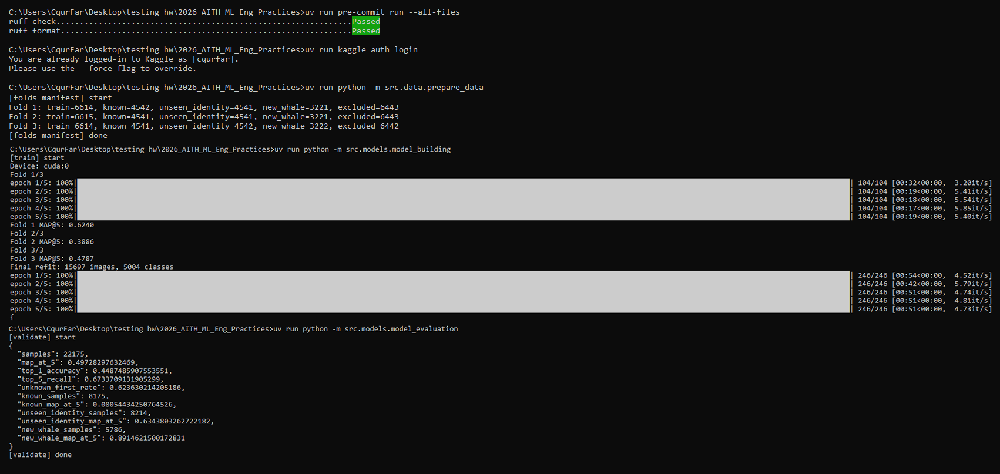
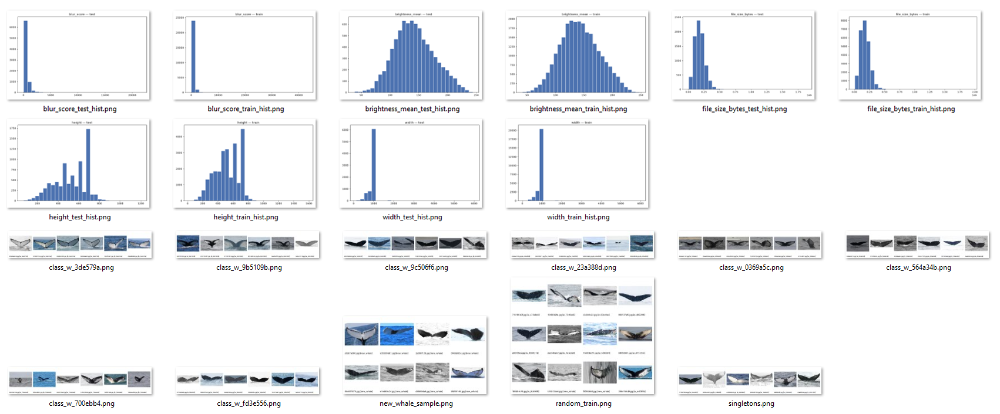

# ДЗ 1. Воспроизводимый ML-проект

## Что сделано

1. **Data Ingestion** — загрузка с Kaggle в `data/raw/`
2. **Data Audit** — проверка данных, структуры и разметки
3. **EDA** — исследование распределений, дубликатов и метаданных изображений
4. **Preprocessing** — ресайз, центрирование, нормализация по статистикам, аугментация
5. **Training** — модель `MobileNetV3-Small` с 3-fold CV, есть чекпоинты после каждой эпохи
8. **Evaluation** — оценка качества модели, OOF метрики по группам (`known / unseen_identity / new_whale`)
9. **Prediction** — `artifacts/hw1-baseline/submission.csv` (top-5 кандидатов на тесте)

## Результаты

- `artifacts/hw1-baseline/model.pkl` — обученная модель
- `artifacts/hw1-baseline/metrics.json` — метрики
- `artifacts/hw1-baseline/oof.json` — out-of-fold предсказания
- `artifacts/hw1-baseline/submission.csv` — submission на тесте
- `artifacts/hw1-baseline/checkpoints/fit_<role>_<fold-or-final>_<hash>.pt` — чекпоинты
- `artifacts/hw1-baseline/logs/` — логи обучения
- `artifacts/hw1-baseline/eda/` — артефакты eda

## Out-of-Fold

```bash
{
  "samples": 22133,
  "map_at_5": 0.5949818521363274,
  "top_1_accuracy": 0.5408665793159535,
  "top_5_recall": 0.7557041521709664,
  "unknown_first_rate": 0.7074955948131749,
  "known_samples": 8155,
  "known_map_at_5": 0.23489066012671161,
  "unseen_identity_samples": 8179,
  "unseen_identity_map_at_5": 0.7832497860374129,
  "new_whale_samples": 5799,
  "new_whale_map_at_5": 0.8358337644421452
}
```

## Скриншоты





## Основные библиотеки

- `Python 3.14`, `uv`, `Ruff 0.17.6`, `pre-commit 4.7.0`, `pytest 9.2.0`
- `PyTorch 2.14.1+cu130`, `torchvision 0.29.1+cu130`
- `polars 2.1.0`, `numpy 2.5.5`, `matplotlib 3.11.2`, `Pillow 13.0.0`
